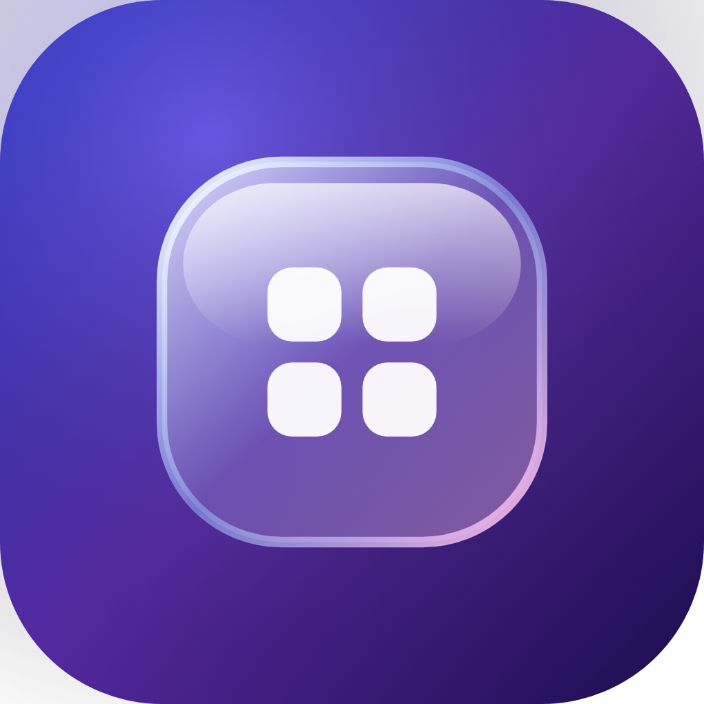

<h1 align="center">Prism Launcher</h1>

A frosted-glass home screen for Android gaming handhelds. Built for the Retroid Pocket 6.

<a href="https://tattoo-designer.github.io/prism-launcher/launcher.html">Website</a> · <a href="https://github.com/Tattoo-Designer/prism-launcher/releases/latest">Download APK</a> · <a href="https://ko-fi.com/prismapps">Support on Ko-fi</a>

## What it is
- Console tiles with real console art, favorites first, full gamepad navigation.
- Game shelves with box art, scanned from your own folders.
- Launches the emulators you already have (RetroArch, Dolphin, PPSSPP, DuckStation, melonDS and more) and native Android ports.
- Lite mode turns off motion to save battery.

## Install
1. Download the APK from the [latest release](https://github.com/Tattoo-Designer/prism-launcher/releases/latest), or add this repo to [Obtainium](https://github.com/ImranR98/Obtainium) for automatic updates.
2. Allow "Install unknown apps" for your browser when Android asks.
3. Open it and choose Prism Launcher as your Home app. You can switch back any time in Settings > Default apps.

Requires Android 10+. No ROMs, BIOS files or games are included; bring your own.

## Support
Prism Launcher is free and open source. If it made your handheld nicer, [tips on Ko-fi](https://ko-fi.com/prismapps) pay for test devices and the time spent on updates.

## License
GPL-3.0. Console photos by Evan-Amos (public domain) and others as listed in [CREDITS](docs/media/consoles/CREDITS.md). Not affiliated with Sony, Nintendo, Sega or Google.
